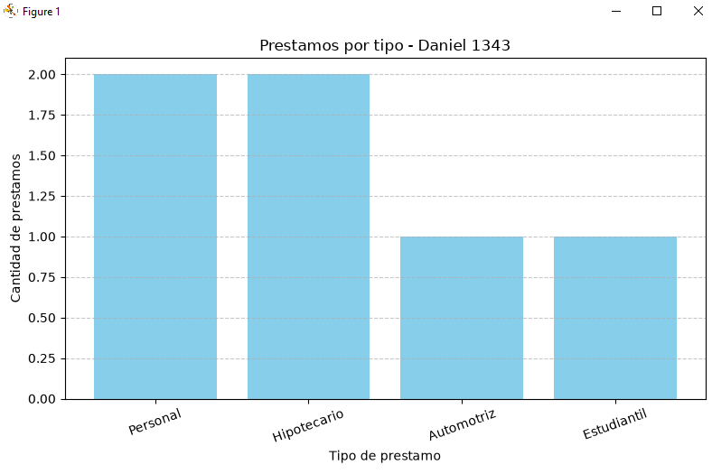
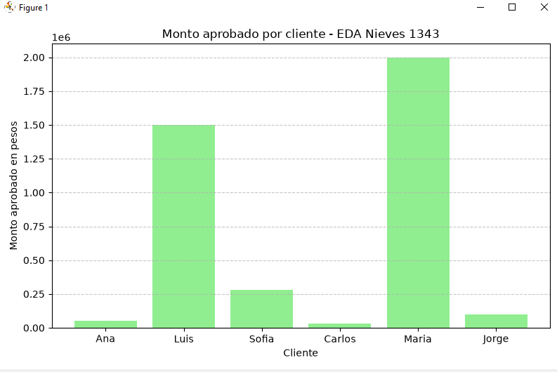
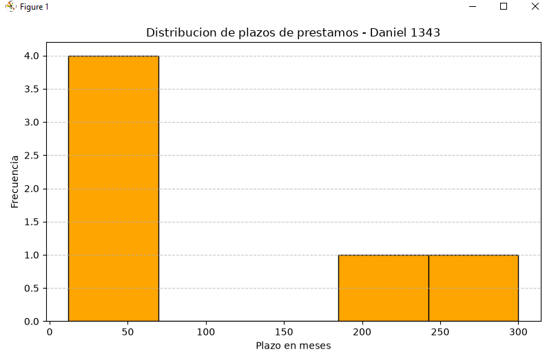
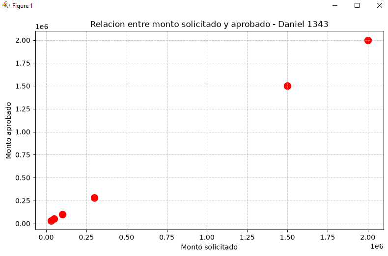
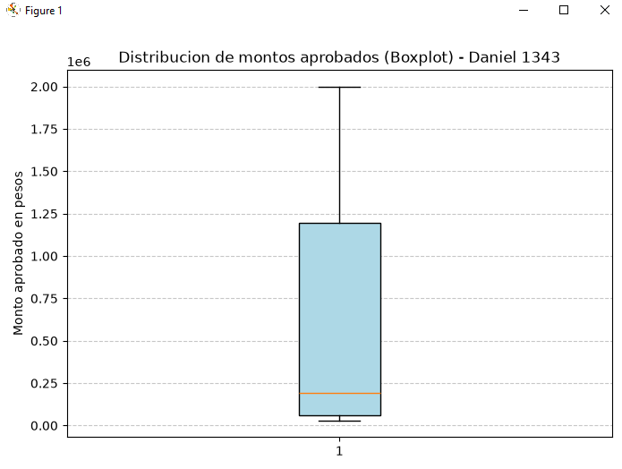
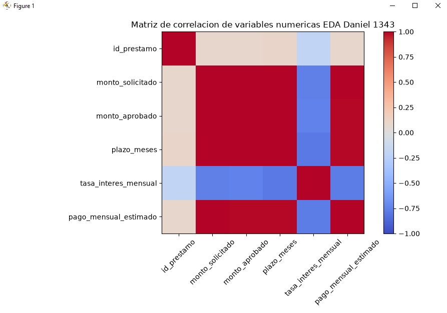
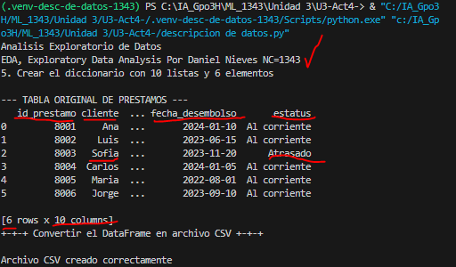

## tipo de prestamos

## monto aprobado por cliente

## distribucion de plazos de prestamos

## relacion entre monto solicitado y aprobado

## distribucion de montos aprobados

## matriz de coorelacion de variables numericas

## tabla original
